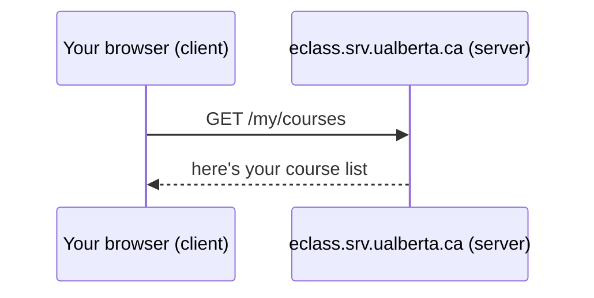

# 01 What is a server?

A server isn't a special type of computer. It's any computer running a program that waits for requests and answers them. Your laptop turns into a server as soon as you run one of those programs, which is exactly what we're doing today.

## Clients and servers

Whenever you use the internet, two programs are talking to each other. The **client** asks for something (your browser, the Instagram app, Minecraft) and the **server** answers (the computer holding the web page, the photos, the game world).

The same machine can be a client and a server at the same time. "Server" is a role, not a kind of hardware.

## Kinds of servers

| Server | Serves | You've used |
|---|---|---|
| Web | Web pages and apps | eClass, every website |
| File / photo | Your files | Google Drive, iCloud |
| Media | Video and music | Netflix, Spotify |
| DNS | Turns names into IP addresses | Every time you type a URL |
| Database | Data for other servers | Behind almost every app |
| Game | A shared game world | Minecraft, Valorant |

Most real apps are a few of these working together. Immich (one of the apps in [04 Explore](04-explore/)) is four: a web server, a machine learning service, a database and a cache.

## Where servers live

- **Data centres**: buildings full of rack-mounted computers with backup power, cooling and fast internet.
- **The cloud**: renting time on those computers from Google, Amazon or Microsoft. It's just someone else's server.
- **A home lab**: servers you run yourself, at home, to learn on and to replace stuff you'd otherwise pay for.

## Four things you need to know for today

**IP addresses** tell you which computer. Every device on a network has one, like `192.168.1.42`. There's also a special one, `127.0.0.1` (also called `localhost`), which always means "this computer". Everything today runs on your own laptop, so every address we use starts with `http://localhost`.

**Ports** tell you which program on that computer. One machine can run lots of servers, and each one listens on a numbered port. Websites use 80 and 443, DNS uses 53, SSH uses 22, Minecraft uses 25565. So `http://localhost:8080` means "the program on port 8080 on this computer".

**DNS** is the internet's phone book. Computers use IP addresses, people use names, and DNS converts `google.com` into an IP. Your device asks a DNS server before it connects to almost anything, which means a DNS server can block ads by refusing to look up ad companies' domains. That's what Pi-hole does.

**Your network vs the internet.** Your router gives devices at home private addresses (`192.168.x.x` or `10.x.x.x`). Devices on the same network can reach each other, but nothing on the internet can reach in unless you open it up on purpose. That's a big part of why a home lab is a safe place to experiment.

## Why people run home labs

- **To learn.** Linux, networking, Docker, databases and security are all things you'll see in DevOps, cloud and backend co-op postings, and you learn them a lot faster when it's your own stuff.
- **To own their data.** Your photos on your own hardware instead of someone else's.
- **To save money.** One small computer can replace a few subscriptions.
- **Because it's fun.**

## What people run them on

| | Roughly | Notes |
|---|---|---|
| Your laptop | Free | Fine for learning, but it's off when the lid is closed |
| An old laptop or desktop | Free | A good first always-on server |
| Raspberry Pi 5 | $100–150 CAD | Small and low power, good for Pi-hole and light apps |
| Used mini PC (Lenovo Tiny, Dell Micro, HP Mini) | $100–250 CAD used | What most people end up with. Quiet, cheap to run, handles a lot |
| NAS | $$$ | When you need a lot of storage |

Pretty much all of these run Linux, and most of the software on them runs in Docker. Which is next.

## Quick question

Which service you use or pay for would you want to run yourself? And what would worry you about doing it?

Next: [02 Docker crash course](02-docker-crash-course.md)
