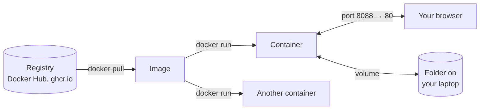
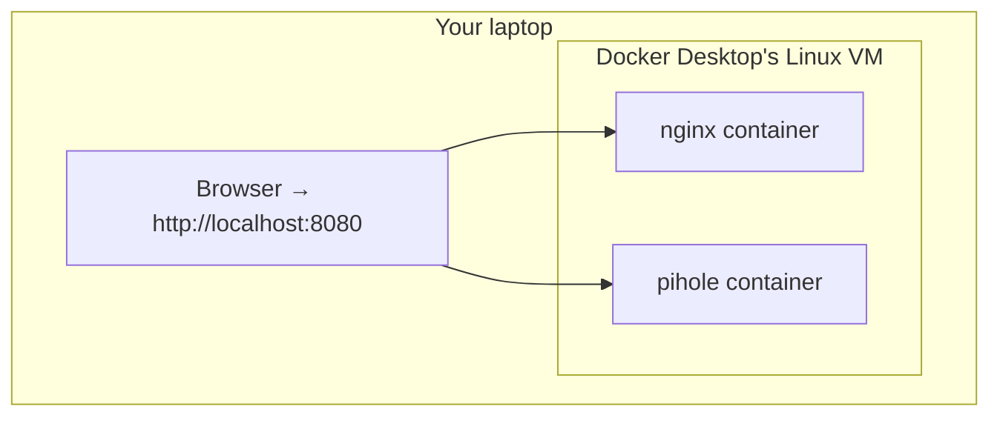

# 02 Docker crash course

## Why Docker exists

You've probably heard (or said) "it works on my machine". Apps need a certain language version, certain libraries, config files in certain places, sometimes a database. Installing all of that directly on your computer is slow, it breaks other things, and it's different on every OS.

Docker packages an app with everything it needs, so it runs the same way on any machine.

## The words you need



- **Image**: a read-only package with the app and everything it needs. Think of it like a recipe, or a class in Java.
- **Container**: a running copy of an image. The dish you made from the recipe, or an object made from the class. You can run lots of containers from one image.
- **Registry**: where images are downloaded from. Docker Hub is the main one; GitHub has one too (ghcr.io).
- **Port mapping**: connects a port on your laptop to a port inside the container, so you can reach the app.
- **Volume**: a folder that lives outside the container, so the data is still there when the container is gone.

The most important idea today: **containers are disposable.** You delete and recreate them all the time, to update them or fix them. Anything you want to keep has to be in a volume.

### Containers vs virtual machines

```
   Virtual machines                     Containers
┌───────┐ ┌───────┐ ┌───────┐   ┌───────┐ ┌───────┐ ┌───────┐
│ App A │ │ App B │ │ App C │   │ App A │ │ App B │ │ App C │
│ Libs  │ │ Libs  │ │ Libs  │   │ Libs  │ │ Libs  │ │ Libs  │
│Full OS│ │Full OS│ │Full OS│   └───────┘ └───────┘ └───────┘
└───────┘ └───────┘ └───────┘   ┌─────────────────────────────┐
┌───────────────────────────┐   │   Docker + shared Linux     │
│        Hypervisor         │   │          kernel             │
└───────────────────────────┘   └─────────────────────────────┘
          Hardware                         Hardware
```

A VM pretends to be a whole computer and boots a full OS, so it's gigabytes in size and takes a while to start. A container shares the Linux kernel of the machine it's on and only packs the app's own files, so it's small and starts in about a second. You can run dozens on a laptop.

### How this works on your laptop

Containers need a Linux kernel. On Windows and Mac, Docker Desktop runs a small Linux VM in the background and all your containers live inside it. On Linux, they run directly.



So today your laptop is the server and your browser is the client, on the same machine.

## How companies use it

Docker isn't just a hobby thing. It's a normal part of how software gets built and shipped, which is why it keeps showing up in co-op postings.

- **Development**: a new hire runs one command and gets the whole stack (database, cache, backend) running locally, the same as everyone else on the team.
- **Testing (CI/CD)**: every commit gets built and tested in a fresh container on GitHub Actions or GitLab, so tests don't depend on anyone's laptop.
- **Deployment**: the exact image that passed the tests is what goes to production.
- **Microservices**: big apps get split into lots of small services, each in its own container, each updated on its own.
- **Kubernetes**: at scale, Kubernetes runs thousands of containers across many machines, restarts the ones that crash and adds more when traffic goes up.
- **Cloud**: AWS, Google Cloud and Azure all have services where you hand them an image and they run it.
- **Embedded and robotics**: ROS 2 projects and edge boards like NVIDIA Jetson are commonly developed and deployed with containers too.

The commands we use today are the same ones people use at work.

## Hands-on

Open a terminal (PowerShell on Windows, Terminal on Mac) and make sure Docker Desktop says Engine running.

### 1. Hello world

```bash
docker run --rm hello-world
```

Docker found the `hello-world` image (or downloaded it), started a container from it, the container printed a message, and `--rm` deleted the container when it finished.

### 2. A real app in one command

```bash
docker run -d --name it-tools -p 8081:80 corentinth/it-tools
```

Go to http://localhost:8081. That's a full web app with around 80 developer tools, running on your laptop.

Breaking the command down:

- `-d` runs it in the background ("detached")
- `--name it-tools` gives it a name we can use later
- `-p 8081:80` connects port 8081 on your laptop to port 80 in the container. It's always `laptop:container`.
- `corentinth/it-tools` is the image

A few commands to look around with:

```bash
docker ps                  # what's running
docker logs it-tools       # what the app has printed
docker stats --no-stream   # CPU and memory use
```

You can see the same things in Docker Desktop under Containers.

### 3. Volumes: your own website

```bash
cd crash-course
docker run -d --name my-site -p 8088:80 -v "${PWD}/site:/usr/share/nginx/html:ro" nginx:alpine
```

(Use PowerShell on Windows for this one, not Command Prompt.)

Go to http://localhost:8088. Now open `crash-course/site/index.html` in any editor, put your name in, save, and refresh the page. It updates right away, because the container is reading that folder straight off your laptop through the volume (`-v laptop_folder:container_folder`). The `:ro` makes it read-only, so the container can read your files but not change them.

Now delete the container:

```bash
docker rm -f my-site
```

Refresh and the site is gone. Run the same `docker run` command again and it's back, edits included. The container was thrown away but your files were never inside it.

### 4. Compose

Long `docker run` commands are hard to remember and annoying to share, so most people use Docker Compose, which describes containers in a YAML file. Open `crash-course/compose.yaml`:

```yaml
services:
  my-site:
    image: nginx:alpine
    ports:
      - "8088:80"
    volumes:
      - ./site:/usr/share/nginx/html:ro
    restart: unless-stopped

  it-tools:
    image: corentinth/it-tools
    ports:
      - "8081:80"
    restart: unless-stopped
```

It's the same two containers from before, just written down. Delete the ones you made by hand first so the names don't clash:

```bash
docker rm -f my-site it-tools
```

Then, from inside `crash-course`:

```bash
docker compose up -d      # start everything in the file
docker compose ps         # see what's running
docker compose logs -f    # watch the logs (Ctrl+C to stop watching)
docker compose down       # stop and remove everything in the file
```

That's how every app in this repo works: go into its folder, run `docker compose up -d`, open the address in your browser.

### 5. Look inside (if you have time)

```bash
docker compose up -d
docker compose exec my-site sh
```

You're now inside the container. Try `ls /usr/share/nginx/html` or `cat /etc/os-release`. There's not much in there. Type `exit` to get out.

## Recap

- An image is the package, a container is a running copy of it, and a registry is where images come from.
- `-p laptop:container` opens up a port, `-v laptop:container` keeps data.
- Containers get thrown away. Volumes don't.
- Compose writes all of it in a file so one command starts everything.

Everything is on the [cheatsheet](CHEATSHEET.md).

Next: [03 Guided setup: Pi-hole](03-guided-setup/)
