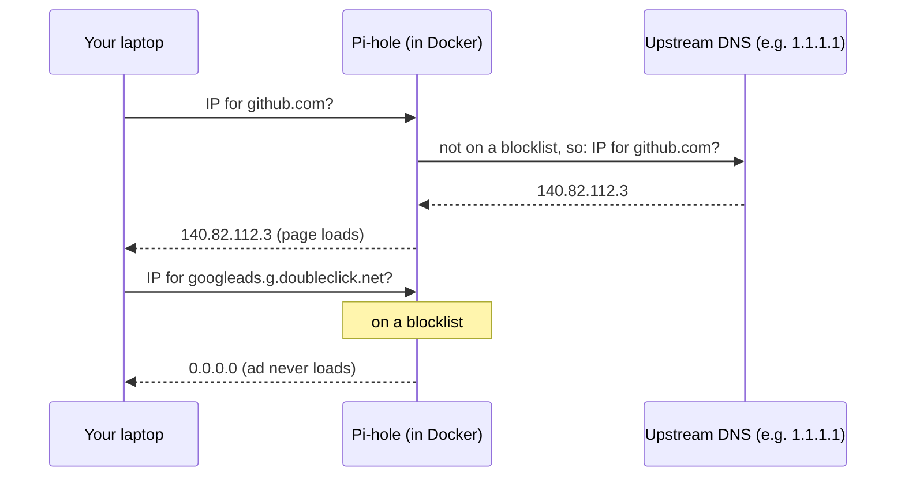

# 03 Guided setup: Pi-hole

We're doing this one together. Follow along on the projector, and if your screen doesn't match what's up there, put your hand up before moving on.

Pi-hole is a DNS server that refuses to look up ad and tracking domains. If you point a device at it (or a whole home network), ads stop loading everywhere, including on phones and smart TVs where you can't install an ad blocker.

By the end you'll have Pi-hole running in Docker with its dashboard, you'll have seen it block an ad domain, and you'll have added your own blocked sites and your own domain name.

## How it works

Before your computer connects to anything, it asks a DNS server for the IP address of the name you typed.



`0.0.0.0` doesn't go anywhere, so the ad request just fails and the page loads without it. Pi-hole comes with a default blocklist covering a huge number of known ad and tracking domains.

## Step 1: Look at the compose file

```bash
cd 03-guided-setup
```

Open `compose.yaml` in any editor. The parts that matter:

- `image: pihole/pihole:latest` is the official Pi-hole image.
- `"127.0.0.1:53:53/udp"` is DNS. DNS always uses port 53. Putting `127.0.0.1` in front means only your laptop can use it, not everyone else on the Wi-Fi.
- `"8080:80/tcp"` is the dashboard, on port 8080 of your laptop.
- `FTLCONF_webserver_api_password` is the dashboard password.
- `./etc-pihole:/etc/pihole` is a volume. Pi-hole's settings get saved into an `etc-pihole` folder right next to the compose file.

Change the password from `change-me-please` to something else and save.

## Step 2: Start it

```bash
docker compose up -d
docker compose logs -f
```

The logs will be busy for a bit while it downloads the default blocklist. Once they settle down, press Ctrl+C (Pi-hole keeps running, you've just stopped watching). Then:

```bash
docker compose ps
```

You should see `pihole` as Up, and after a minute or so, `(healthy)`.

If you get "address already in use" for port 53, something else on your laptop is already using it. Skip to the [port 53 fix](#port-53-is-already-in-use) at the bottom.

## Step 3: Log in

Go to http://localhost:8080/admin and log in with your password.

Have a look around. The Dashboard shows queries and how many got blocked (zero right now), the Query Log shows every lookup as it happens, Lists shows the blocklists, and Domains is where your own rules go.

## Step 4: Watch it block something

`nslookup` is a DNS tool that comes with every OS. The `127.0.0.1` at the end tells it to ask your Pi-hole instead of the normal DNS server.

A normal site:

```bash
nslookup github.com 127.0.0.1
```

You get a real IP address back.

An ad server:

```bash
nslookup googleads.g.doubleclick.net 127.0.0.1
```

You get `0.0.0.0`. Blocked.

Check the Query Log in the dashboard and both lookups are there, one allowed and one blocked.

You can also ask Pi-hole which list a domain is on:

```bash
docker exec pihole pihole -q doubleclick.net
```

## Step 5: Your own rules

**Block a site.** Go to Domains, type `example.com`, and add it as a denied domain. Then:

```bash
nslookup example.com 127.0.0.1
```

Now it comes back as `0.0.0.0`. This is basically how parental controls on a home network work. Remove it from the list when you're done.

**Make up your own domain.** Pi-hole can also answer for names that don't exist on the internet. This is how home labs end up with addresses like `photos.home` instead of `192.168.1.42:2283`.

Go to Settings → Local DNS Records, add `pihole.home` pointing to `127.0.0.1`, and save. Then:

```bash
nslookup pihole.home 127.0.0.1
```

It answers with `127.0.0.1`. You're now running a (very small) piece of DNS.

## Step 6: Your settings survive

```bash
docker compose down
docker compose up -d
```

`down` deleted the container completely. Log back in anyway: your local DNS record and your stats are still there, and `nslookup pihole.home 127.0.0.1` still works. Look in the `03-guided-setup` folder and you'll see the `etc-pihole` folder. That's where all of it lives, which is why it didn't go anywhere.

## Step 7 (optional): Use it for real

You can point your whole laptop at Pi-hole so every app gets ad blocking.

**Important:** while your laptop is using Pi-hole for DNS, if Pi-hole stops, your internet will seem broken because nothing can look up names. Undo this before you stop the container and before you leave today.

<details>
<summary>Windows 11</summary>

Settings → Network & internet → Wi-Fi → Hardware properties → DNS server assignment → Edit → Manual. Turn on IPv4, set Preferred DNS to `127.0.0.1`, save.

To undo: same place, set it back to Automatic (DHCP).
</details>

<details>
<summary>macOS</summary>

System Settings → Wi-Fi → Details (next to your network) → DNS. Click +, add `127.0.0.1`, remove any other entries, OK.

To undo: remove `127.0.0.1` so the list goes back to the greyed-out defaults.
</details>

<details>
<summary>Linux (NetworkManager)</summary>

```bash
nmcli connection show
nmcli connection modify "YOUR-WIFI" ipv4.dns 127.0.0.1 ipv4.ignore-auto-dns yes
nmcli connection up "YOUR-WIFI"
```

To undo:

```bash
nmcli connection modify "YOUR-WIFI" ipv4.dns "" ipv4.ignore-auto-dns no
nmcli connection up "YOUR-WIFI"
```
</details>

If you use Firefox, it may be using its own encrypted DNS and skipping Pi-hole. Turn off DNS over HTTPS in Settings → Privacy & Security.

Now open a news site or a recipe blog and watch the Query Log. It's kind of shocking how many lookups one page makes, and how many of them are trackers.

Then undo the DNS setting.

## How people use it at home

On your laptop, Pi-hole only covers your laptop. At home, people run it on something that's always on (a Raspberry Pi is the classic, hence the name), then set the router to hand out the Pi-hole's address as the DNS server. Every device that joins the Wi-Fi gets ad blocking automatically, guests included. Most people also keep a second DNS server as a backup, because if DNS goes down, the whole house thinks the internet is down.

## If you finish early

- Add another blocklist under Lists, then run Tools → Update Gravity. https://firebog.net has some popular ones.
- Try different upstream DNS servers in Settings → DNS, like Cloudflare (1.1.1.1) and Quad9 (9.9.9.9). Look up how their privacy policies differ.
- Get a shell inside the container with `docker exec -it pihole bash`, run `pihole status`, then `exit`.
- Set up [Homepage](../04-explore/) and add Pi-hole to it.
- Head to [04 Explore](../04-explore/).

## Troubleshooting

### Port 53 is already in use

Some laptops already have something on port 53. Change the two DNS lines in `compose.yaml` to:

```yaml
      - "127.0.0.1:1053:53/tcp"
      - "127.0.0.1:1053:53/udp"
```

Run `docker compose up -d` again, and add `-port=1053` to your lookups:

```bash
nslookup -port=1053 googleads.g.doubleclick.net 127.0.0.1
```

Everything works except Step 7, since operating systems only send DNS to port 53.

### Port 8080 is already in use

Change `"8080:80/tcp"` to `"8090:80/tcp"` and use http://localhost:8090/admin.

### nslookup times out

Pi-hole might still be starting (check `docker compose logs`). If it keeps happening, the Wi-Fi might be blocking outside DNS servers. Ask one of us for the campus DNS server address, put it in `FTLCONF_dns_upstreams`, uncomment that line, and run `docker compose up -d`.

### Can't log in

The password is whatever was in `compose.yaml` the first time Pi-hole started. Reset it with `docker exec -it pihole pihole setpassword`.

### Ads still show up in Step 7

Your browser might be using DNS over HTTPS, or your laptop might be using IPv6 DNS. Not a big deal, Step 4 already showed it working.

## Cleaning up

```bash
docker compose down
```

That stops Pi-hole and keeps your settings in `etc-pihole`. Delete that folder too if you want it all gone.

And if you did Step 7, double check you undid your DNS settings.

Docs: https://docs.pi-hole.net/docker/
