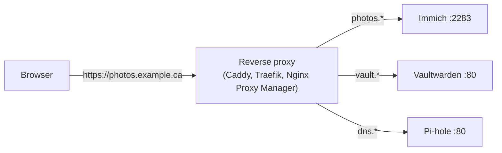

# 06 Learn more

Everything today ran on your laptop and stopped when you closed it. This is what changes when you run a server for real, and how it connects to the stuff companies do.

- [Getting a machine that stays on](#getting-a-machine-that-stays-on)
- [Picking an OS](#picking-an-os)
- [Networking basics](#networking-basics)
- [Remote access](#remote-access)
- [Reverse proxies and HTTPS](#reverse-proxies-and-https)
- [Backups](#backups)
- [Updates](#updates)
- [Security checklist](#security-checklist)
- [More Docker](#more-docker)
- [How this connects to industry](#how-this-connects-to-industry)
- [Project ideas](#project-ideas)

## Getting a machine that stays on

A server has to be on when you need it, like when your phone backs up photos at 2 AM, or when every device in the house needs DNS. So you need something that stays on.

| Option | Idle power, roughly | Notes |
|---|---|---|
| Old laptop | 10–20 W | Free, and the battery works as a backup power supply. Set it to not sleep when the lid's closed. |
| Raspberry Pi 5 | 3–5 W | Tiny and silent. It's ARM, so most images work but a few don't. Use an SSD instead of just an SD card. |
| Used mini PC (Lenovo Tiny, Dell OptiPlex Micro, HP EliteDesk Mini) | 8–15 W | What most people go with. Normal x86, upgradable, cheap used. |
| Old gaming PC | 40–100 W | Powerful, but you'll notice it on the power bill if it's on 24/7. |
| NAS (Synology, QNAP, or DIY) | Varies | When you need a lot of storage. Many can run Docker too. |

Every watt running all year is about 8.8 kWh. Multiply by your electricity rate to see what it costs.

## Picking an OS

- **Ubuntu Server or Debian** is the usual choice. No desktop, huge community, and basically every guide assumes it.
- **Proxmox VE** is a hypervisor, so it runs multiple VMs and containers on one box. It's great for learning and is closer to how data centres work. People usually run Docker inside a VM on it.
- **TrueNAS SCALE** and **Unraid** are built around storage and have their own app stores. Unraid costs money.
- **Raspberry Pi OS Lite** if you're on a Pi.

You'll mostly manage it over SSH from your laptop (`ssh you@192.168.1.50`). Set up SSH keys early with `ssh-keygen` and `ssh-copy-id`, then turn off password login.

## Networking basics

- **Private IPs** (`192.168.x.x`, `10.x.x.x`, `172.16–31.x.x`) only work inside your own network.
- **DHCP** is how your router hands out IP addresses. You want your server's address to stay the same, so set a DHCP reservation for it in your router.
- **Subnets**: `192.168.1.0/24` means everything from `192.168.1.0` to `192.168.1.255`. The `/24` is how many bits are the network part.
- **NAT** is why your whole house shares one public IP. It's also why the internet can't reach your devices by default, which is a good thing.
- **DNS**: run Pi-hole or AdGuard Home on the server, point your router's DNS setting at it, and every device in the house gets it. You can add names like `photos.home` too.
- **Campus and residence networks** usually block devices from talking to each other and block incoming connections, so a home lab is much easier on a network you control.

## Remote access

At some point you'll want to get to your stuff from your phone when you're out. Don't just forward ports on your router to your apps. Bots scan the entire internet constantly, and anything you open up will get found and poked at within hours.

Better options:

- **[Tailscale](https://tailscale.com)** is where most people should start. It's a VPN built on WireGuard: install it on the server and on your phone and they can reach each other from anywhere, without opening any ports. Free for personal use.
- **WireGuard on your own** does the same thing without a third-party service, but you have to open one port and manage it yourself.
- **Cloudflare Tunnel** lets your server make an outgoing connection to Cloudflare, which then serves your app on a real domain. Good if something actually needs to be public. Your traffic does go through Cloudflare, and check their terms before streaming media through it.
- **Port forwarding with a reverse proxy** is the traditional way. Only do it if you know what you're doing, because every app you expose has to be kept patched and properly secured.

## Reverse proxies and HTTPS

Today we used addresses like `localhost:8080` and `localhost:3001`. A reverse proxy sits in front of all your apps and sends traffic to the right one based on the name:



It also gets free HTTPS certificates from Let's Encrypt automatically. Apps like Vaultwarden and Actual Budget need HTTPS to work from anywhere other than localhost.

- **[Caddy](https://caddyserver.com)** has the simplest config and does HTTPS by default. Good first pick.
- **Nginx Proxy Manager** gives you a web interface where you click to add sites.
- **Traefik** is set up with labels on your containers. It's popular in more automated setups and at companies.

A cheap domain (or the free one from the GitHub Student Pack), plus Tailscale, plus Caddy is a really common setup.

## Backups

If your data only exists in one place, you should assume you'll lose it eventually.

The usual rule is 3-2-1: three copies, on two different kinds of storage, with one somewhere else (a friend's place, or cloud storage).

What to back up in a Docker setup:

- Every folder you mounted as a volume (`./data`, `./etc-pihole`, `./library` and so on)
- Every named volume (`docker volume ls`)
- Databases, carefully. Copying a database's files while it's running can give you a broken copy. Use the app's own export or backup feature (Immich makes automatic database dumps in `library/backups`), or stop the app first.
- Your compose files and `.env` files. Put the compose files in a private Git repo, and keep the secrets from `.env` somewhere safe, like a password manager.

[restic](https://restic.net), [Borg](https://www.borgbackup.org) and [Kopia](https://kopia.io) all do encrypted, incremental backups to another drive or to the cloud. Run them on a schedule with cron or a systemd timer.

Actually test restoring from your backup at some point. Plenty of people find out their backups were broken right when they need them.

## Updates

- Pin versions for anything important (like `IMMICH_VERSION=v3.4.1` instead of `latest`) so updates happen when you decide.
- Read the release notes before you update. Some apps occasionally have changes that need a manual step.
- To update:
  ```bash
  docker compose pull
  docker compose up -d
  docker image prune
  ```
  The last line cleans up old images.
- Auto-updaters like Watchtower are convenient, but they can install a breaking update at 3 AM. A lot of people use something that just notifies them, like [Diun](https://crazymax.dev/diun/), and update by hand.
- Keep the OS itself updated too (`sudo apt update && sudo apt upgrade` on Debian or Ubuntu).

## Security checklist

- [ ] Nothing is open to the internet except through a VPN, a tunnel or a properly set up reverse proxy
- [ ] SSH uses keys only, and root can't log in
- [ ] Every app has its own strong password
- [ ] Sign-ups are turned off on apps that are just for you and your family
- [ ] `docker.sock` is only given to apps that really need it, read-only where possible
- [ ] Databases and internal services don't have a `ports:` line
- [ ] `.env` files and secrets aren't in Git
- [ ] Backups are running, and you've tested restoring one
- [ ] You know how to check logs with `docker compose logs`

## More Docker

### Building your own image

Everything today used images someone else made. A Dockerfile is how you package your own code:

```dockerfile
FROM python:3.12-slim
WORKDIR /app
COPY requirements.txt .
RUN pip install --no-cache-dir -r requirements.txt
COPY . .
CMD ["python", "bot.py"]
```

```bash
docker build -t my-bot .
docker run -d --name my-bot --env-file .env my-bot
```

Docker caches each step, so copying `requirements.txt` before the rest of the code means it doesn't reinstall everything every time you change a line.

### Things to look up next

- **Networks**: Compose makes a private network for each project, and containers find each other by name. You can also make networks that are shared between projects.
- **Health checks**: a command Docker runs to check a container actually works, not just that it's running.
- **Multi-stage builds**: build in one stage, then copy only what you need into a small final image.
- **Tags vs digests**: `:latest` changes over time, `@sha256:...` never does.
- **Resource limits**: stop one container from using all your RAM.
- **Non-root containers**: running the app as a normal user inside the container limits the damage if it gets compromised.
- **Secrets**: Compose has a `secrets:` option that's better than putting passwords in environment variables.

## How this connects to industry

| Home lab | At work |
|---|---|
| `compose.yaml` files | Infrastructure as code |
| Keeping them in Git | GitOps |
| A few containers working together | Microservices |
| Uptime Kuma alerts | Monitoring and on-call (Prometheus, Grafana, PagerDuty) |
| Backups you've tested | Disaster recovery |
| Reverse proxy with HTTPS | Ingress, load balancers, TLS termination |
| Tailscale | Zero-trust networking |
| Reading release notes before updating | Change management |

If you're into this, look at:

- **Kubernetes**, which runs containers across lots of machines. [k3s](https://k3s.io) is a lightweight version that runs fine on a mini PC or a few Raspberry Pis.
- **CI/CD**: have GitHub Actions build and push your own image every time you commit.
- **Automation**: [Ansible](https://www.ansible.com) for setting up servers from code, Terraform or OpenTofu for creating cloud resources from code.
- **Cloud**: deploy a container to Google Cloud Run, AWS or Azure using student credits.

That's the skill set behind DevOps, SRE, cloud and platform roles, and it shows up in a lot of backend, embedded and robotics postings too.

### On your résumé

"Familiar with Docker" doesn't say much. Something like "Run a home lab (Proxmox, Docker Compose) with 8 services including photo backup and network-wide ad blocking for 4 users; automated encrypted off-site backups with restic; remote access through Tailscale" says a lot more. Put your compose files in a public GitHub repo (without the secrets) and link it.

## Project ideas

1. A family photo server: Immich on a mini PC, Tailscale for everyone's phones, and a nightly backup to an external drive.
2. Ad blocking for the whole house: Pi-hole on a Raspberry Pi set as the router's DNS, with a second one as a backup.
3. A dashboard for everything: Homepage with live widgets, and Uptime Kuma sending you Discord alerts.
4. Containerize a course project with a Dockerfile and a compose file so anyone can run it with one command, then have GitHub Actions build the image.
5. A local AI setup: Ollama and Open WebUI on a machine with a GPU, plus n8n automations that use it.

[Back to the README](README.md)
